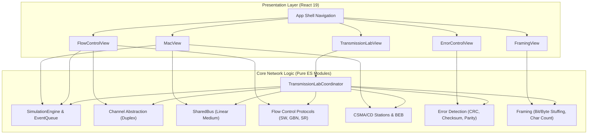
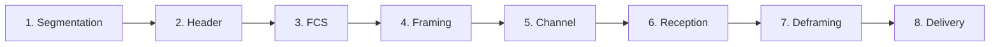
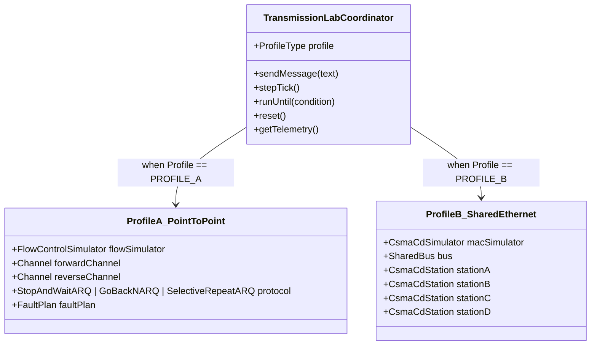

# ARCHITECTURE.md — System Architecture & Design Specification

> **Project:** Interactive Data Link Layer Protocol Simulator  
> **Course:** Computer Networks (Semester V)  
> **Specification Version:** 1.0.0 (Phase 9 Final Hardening)

---

## 1. High-Level Architectural Philosophy

The **Interactive Data Link Layer Protocol Simulator** is structured around three foundational design tenets:

1. **Strict Decoupling of Network Logic from UI:**  
   The network algorithms, state machines, channel models, and mathematical utilities in `src/core/` are 100% pure JavaScript ES modules. They contain zero imports from React, the DOM, or external UI libraries. The React presentation layer in `src/ui/` acts strictly as an observational consumer that subscribes to engine state snapshots and renders clean, accessible visual representations.

2. **Deterministic Discrete-Event Simulation Engine:**  
   Real-time asynchronous wall-clock delays (`setTimeout`, `setInterval`) are fundamentally non-deterministic and susceptible to event-loop jitter. In an academic or viva defense setting, race conditions destroy repeatability. All timing in this simulator is governed by a priority-queue-based discrete-event scheduler (`SimulationEngine`). Time progresses in discrete virtual ticks. Every transmission, timeout, propagation wavefront, and retransmission is an explicit scheduled event. This enables single-tick stepping, pausing, instant execution, and 100% reproducible test vectors.

3. **Dual Complementary Learning Experiences:**  
   - **Learning Playground:** Standalone algorithm visualizers for deep examination of individual protocols (Framing, Error Control, Sliding Window ARQ, and CSMA/CD).
   - **End-to-End Transmission Lab:** An integrated multi-layer pipeline where an upper-layer payload undergoes segmentation, header formatting, error-control encoding, framing transparency, channel transmission with fault injection, receiver deframing, FCS verification, and delivery.

---

## 2. Directory Structure & Module Responsibilities

```text
c:/Users/lenovo/OneDrive/Desktop/College Innovative Assignments/SEM V/CN/
├── docs/                                 # Living documentation & viva materials
│   ├── ARCHITECTURE.md                  # This technical architectural specification
│   ├── DEMO_GUIDE.md                    # Step-by-step reproducible viva demonstration script
│   ├── VIVA_GUIDE.md                    # Comprehensive viva cheat sheet & examiner Q&A
│   ├── FINAL_AUDIT.md                   # Final Phase 9 audit records & acceptance tests
│   ├── PROJECT_CONTEXT.md               # Requirements, standards references, and scope
│   ├── TASKS.md                         # Task roadmap & status tracker
│   └── TESTING.md                       # Complete test execution log across phases
├── src/
│   ├── core/                            # 100% Pure JavaScript Networking Modules
│   │   ├── engine/                      # Discrete-Event Simulation Engine
│   │   │   ├── EventQueue.js            # Priority queue ordered by virtual tick
│   │   │   ├── SimulationEngine.js      # Virtual clock, stepping, scheduling, pausing
│   │   │   └── Channel.js               # Duplex channel with drop/corrupt/delay faults
│   │   ├── framing/                     # Layer-2 Framing Transparency
│   │   │   ├── bitStuffing.js           # HDLC bit stuffing & destuffing (01111110)
│   │   │   ├── byteStuffing.js          # RFC 1662 PPP octet stuffing & generic escape
│   │   │   └── charCount.js             # Tanenbaum length-prefixed character count
│   │   ├── error-control/               # Layer-2 Error Detection
│   │   │   ├── crc.js                   # Modulo-2 division, CRC-8/SMBus, CRC-16/CCITT
│   │   │   ├── checksum.js              # RFC 1071 16-bit Internet Checksum
│   │   │   ├── parity.js                # 1D Parity & 2D Parity matrix localization
│   │   │   └── errorInjection.js        # Deterministic bit-flipping & burst corruption
│   │   ├── flow-control/                # Sliding Window Flow Control & ARQ
│   │   │   ├── sequenceMath.js          # Modulo 2^m circular window arithmetic
│   │   │   ├── stopAndWait.js           # Stop-and-Wait ARQ state machine (m=1)
│   │   │   ├── goBackN.js               # Go-Back-N ARQ state machine (cumulative ACK)
│   │   │   ├── selectiveRepeat.js       # Selective Repeat ARQ (out-of-order buffer)
│   │   │   └── FlowControlSimulator.js  # Facade coordinating ARQ with dual channels
│   │   ├── mac/                         # Medium Access Control (Ethernet CSMA/CD)
│   │   │   ├── SharedBus.js             # Spatial linear broadcast medium with delays
│   │   │   ├── backoff.js               # IEEE 802.3 Truncated BEB (attemptLimit=16)
│   │   │   ├── csmaCd.js                # 1-persistent CSMA/CD station state machine
│   │   │   └── CsmaCdSimulator.js       # 4-station bus contention coordinator
│   │   ├── frame/                       # Canonical Frame Contracts
│   │   │   └── FrameContract.js         # Plain frame objects, binary serialization
│   │   └── transmission/                # Flagship Integrated Experience
│   │       └── TransmissionLabCoordinator.js # 8-stage pipeline orchestrator
│   ├── ui/                              # Pure React Presentation Layer
│   │   ├── modules/                     # Standalone and integrated views
│   │   │   ├── FramingView.jsx          # Framing visualizer & abort demonstration
│   │   │   ├── ErrorControlView.jsx     # Step-by-step CRC table & 2D grid
│   │   │   ├── FlowControlView.jsx      # Multi-lane ARQ visualizer & sliding windows
│   │   │   ├── MacView.jsx              # Shared bus rail with animated wavefronts
│   │   │   └── TransmissionLabView.jsx  # 8-stage pipeline stepper & frame inspector
│   │   └── App.jsx                      # Navigation shell with tab switching
│   ├── styles/
│   │   └── index.css                    # Pure CSS variables, layout, and components
│   └── tests/                           # Vitest Unit and Integration Test Suites
│       ├── sanity.test.js               # Test runner & XOR truth table verification
│       ├── engine.test.js               # EventQueue & SimulationEngine tests (22)
│       ├── framing.test.js              # Bit, byte, character count framing tests (34)
│       ├── errorControl.test.js         # CRC, Checksum, 1D/2D parity tests (36)
│       ├── flowControl.test.js          # Stop-and-Wait, GBN, Selective Repeat tests (35)
│       ├── mac.test.js                  # SharedBus, CSMA/CD, Jam, Backoff tests (19)
│       └── transmissionLab.test.js      # Integrated pipeline, Profile A & B tests (23)
├── package.json                         # Project metadata, dependencies, scripts
├── vite.config.js                       # Vite bundler & Vitest configuration
└── README.md                            # High-level project entry point
```

---

## 3. Subsystem Breakdown & Component Interactions



---

## 4. Canonical Frame Contract & Wire Formats

All frames in the simulator are defined by plain serializable JavaScript objects according to [`FrameContract.js`](file:///c:/Users/lenovo/OneDrive/Desktop/College%20Innovative%20Assignments/SEM%20V/CN/src/core/frame/FrameContract.js).

### Frame Object Schema
```javascript
{
  frameId: 'FRAME_1_SEQ_0',      // Unique tracking identifier
  type: FrameType.DATA,          // 'DATA', 'ACK', 'NAK'
  seq: 0,                        // Transmit sequence number (0 to 2^m - 1)
  ack: 0,                        // Acknowledged sequence number
  payloadText: 'HELLO',          // Human-readable payload string
  payloadBytes: Uint8Array,      // Raw payload octets
  fcs: '0x29B1',                 // Checksum or CRC verification field
  fcsType: 'CRC-16',             // Name of integrity algorithm used
  framingType: 'BYTE_STUFFING',  // Framing scheme applied
  framedData: Uint8Array|string, // Wire representation with flags/stuffing
  corrupted: false,              // Channel corruption flag
  dropped: false,                // Channel drop flag
  inFlight: false,               // True while traversing transmission channel
  departureTick: 10,             // Scheduled departure virtual tick
  arrivalTick: 14                // Scheduled arrival virtual tick
}
```

### Binary Wire Serialization
For wire transmission, frames are serialized into packed byte streams:
- **Compact Header Format (2 bytes):**
  - Octet 0: `[Type (2 bits) | Seq (3 bits) | Ack (3 bits)]`
  - Octet 1: `Payload Length` (0–255 octets)
- **Extended Header Format (4 bytes):**
  - Octet 0: Frame Type (`0x01` DATA, `0x02` ACK, `0x03` NAK)
  - Octet 1: Sequence Number (0–255)
  - Octet 2: Acknowledged Sequence Number (0–255)
  - Octet 3: Payload Length
- **Payload & FCS:**
  - Octets 4 to $4+L-1$: Raw payload data
  - Trailing octets: FCS field (1 byte for CRC-8/Parity, 2 bytes for CRC-16/Checksum)

---

## 5. The 8-Stage Transmission Pipeline Lifecycle

In the **End-to-End Transmission Lab**, a frame's end-to-end traversal is logged across 8 discrete lifecycle stages:



1. **Stage 1: Upper-Layer Payload & Segmentation:**  
   The user enters a message string. The upper-layer coordinator chunks the string into segments of at most `maxPayloadChunk` bytes (e.g., 2–5 bytes per frame).
2. **Stage 2: Frame Header Assembly:**  
   The protocol state machine assigns the next valid sequence number $S_n$, current expected acknowledgement $R_n$, and frame type (`DATA`).
3. **Stage 3: Error Detection Encoding:**  
   The selected error-detection algorithm computes the Frame Check Sequence (FCS) across the concatenated header and payload bytes.
4. **Stage 4: Framing & Transparency:**  
   The frame is delimited by opening/closing flags (e.g., `0x7E` or `01111110`) or length headers. Flag patterns inside the payload/FCS are escaped via bit stuffing (HDLC) or octet stuffing (RFC 1662).
5. **Stage 5: Physical Channel Transmission:**  
   The framed stream is serialized onto the medium. Interactive fault injection may mark the frame for `PASS`, `DROP`, `CORRUPT` (flipping a bit in the physical stream), or `DELAY`.
6. **Stage 6: Physical Medium Reception:**  
   The signal arrives at the receiver after propagation delay $T_p$. The physical arrival event is recorded on the timeline.
7. **Stage 7: Deframing, Wire Parsing & FCS Verification:**  
   The receiver removes framing flags and destuffs the wire stream. Sequence and payload fields are extracted directly from destuffed bytes. The receiver recomputes the FCS over the wire bytes and compares it against the transmitted FCS. If corrupted, deframing or FCS verification fails, and the frame is rejected.
8. **Stage 8: Upper-Layer Delivery / ARQ State Transition:**  
   If valid and in-sequence, the payload is delivered to the upper layer. The receiver emits an ACK, sliding windows advance, and timers are updated.

---

## 6. The Two Simulation Profiles



### Profile A: Point-to-Point ARQ
- **Medium Model:** Full-duplex dedicated channels (Forward DATA channel, Reverse ACK channel).
- **Protocols Supported:** Stop-and-Wait ARQ, Go-Back-N ARQ, Selective Repeat ARQ.
- **Fault Injection:** Direct interactive injection of bit corruption, frame drops, and latency jitter.
- **Delivery Guarantee:** End-to-end reliability provided by sliding window retransmission timers and acknowledgements.

### Profile B: Shared-Medium Ethernet
- **Medium Model:** Linear shared broadcast bus connecting 4 stations (A, B, C, D) positioned at $0\,\text{m}$, $100\,\text{m}$, $200\,\text{m}$, and $300\,\text{m}$.
- **Contention Mechanism:** 1-persistent CSMA/CD with local carrier sensing and bilateral propagation speed $c = 200\,\text{m/\mu s}$.
- **Collision Detection:** Stations listen while transmitting; overlapping wavefronts within $2\tau$ trigger collision detection.
- **Collision Recovery:** Immediate transmission abort, 32-bit jam signal (4 ticks), followed by IEEE 802.3 Truncated Binary Exponential Backoff ($k \le 10$, slots $0 \le r < 2^k$, attempt limit 16).
- **Protocol Separation:** Does **NOT** invoke sliding-window ARQ state machines. Frame delivery occurs when the signal wavefront departs the destination station tap cleanly.

---

## 7. Mathematical Formulas & Performance Metrics

### Propagation Delay & Collision Window
$$\tau = \frac{d}{c}$$
- Bus length $d = 300\,\text{m}$, Propagation speed $c = 200\,\text{m/\mu s}$ $\implies \tau = 1.5\,\mu\text{s}$ (modeled as $10\,\text{virtual ticks}$).
- Maximum round-trip propagation time:
$$T_{\text{slot}} = 2\tau = 20\,\text{ticks}$$
- Minimum frame transmission duration constraint to guarantee collision detection before transmission ends:
$$T_t \ge 2\tau$$

### Binary Exponential Backoff (BEB)
$$k = \min(c, 10)$$
$$r \in [0, 2^k - 1]$$
$$\text{Backoff Delay} = r \times T_{\text{slot}}$$

### Flow Control Utilization & Performance Metrics
1. **Channel Utilization ($U_{\text{channel}}$):**
   $$U_{\text{channel}} = \frac{\text{Ticks Medium Was Occupied}}{\text{Total Elapsed Simulation Ticks}}$$
2. **Transmission Success Ratio ($S_{\text{tx}}$):**
   $$S_{\text{tx}} = \frac{\text{Frames Successfully Delivered}}{\text{Total Transmission Attempts (Initial + Retransmissions)}}$$
3. **Useful Utilization ($U_{\text{useful}}$):**
   $$U_{\text{useful}} = U_{\text{channel}} \times S_{\text{tx}}$$
4. **Goodput ($G$):**
   $$G = \frac{\text{Total Delivered Payload Bits}}{\text{Elapsed Simulation Ticks}}$$
